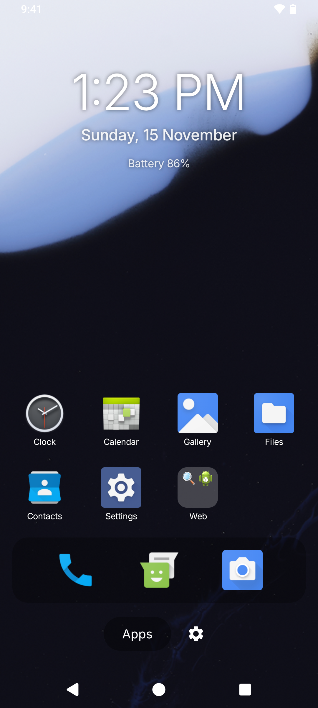
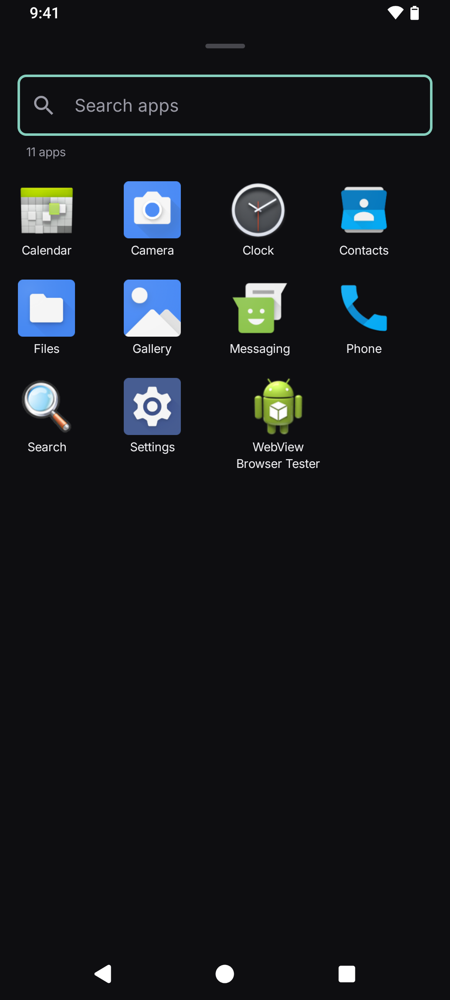
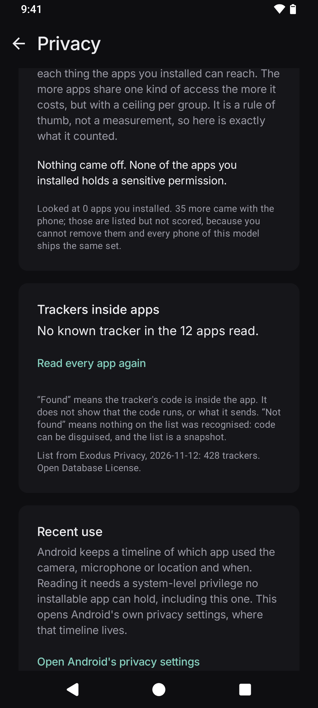
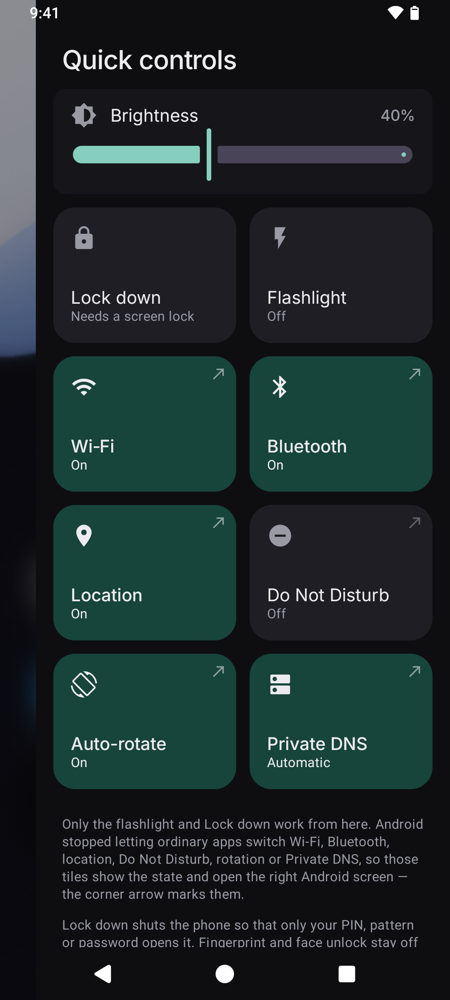

# Privacy Launcher

A home screen for Android that cannot reach the internet.

It has no internet permission at all. It asks for two permissions, and
neither does anything until you switch on the feature that needs it. Everything it knows
stays on the phone. It is about 2.3 MB, written in Kotlin with Jetpack
Compose, and runs on Android 8.0 and later.

<p>
  
  
  
  
</p>

> **Tested on emulators only.** Version 1.0 has been run on Android
> emulators: Android 11 and Android 15, on seven screen shapes from a
> 320 dp wide phone to an opened folding phone. It has not yet been tried on
> a physical phone. If you try it on yours, an issue saying how it went is
> very welcome.

## The privacy promise

Each of these is checked by a test against the installed app, not only
written down.

- **No internet.** The internet permission is not just unused: it is removed
  from the app, along with network-state access and the advertising ID, so
  no library can bring them back.
- **Two permissions, both asleep until you use them.** *Contacts*, only for
  searching contacts from the app drawer, and only once you switch that on.
  *Modify system settings*, only for the brightness slider, granted on
  Android's own screen. (A third line in the manifest is added by AndroidX;
  it only lets the app talk to itself.)
- **No tracking code.** No analytics, crash reporting, ads or Google Play
  Services. The launcher's own tracker scan finds none of the 428 known
  trackers in it.
- **Nothing leaves the phone.** Settings stay in the app's private storage.
  Android's cloud backup and device transfer are switched off. A backup is a
  file you choose and keep.
- **Two optional abilities, off until you turn them on in Android's
  settings.** An accessibility service that can open the notification shade
  and lock the screen, and is refused everything else. And, for Lock down,
  a device admin right that can lock the screen and nothing else.
- **Every library is open source**, each listed with its licence
  [below](#dependencies-and-licences).

Check the permissions yourself, on the APK you downloaded:

```bash
aapt2 dump permissions app-release.apk
```

[docs/privacy.md](docs/privacy.md) has the details, including exactly what
contact search reads and why each of the two permissions exists.

## What it does

- **Home screen.** The time and date; an offline line with the next alarm
  and the battery; an editable grid with folders; a dock; and drag and drop
  between the grid, the dock and the app drawer.
- **App drawer.** Follows your finger. Instant search that forgives typos,
  and a letter bar for long lists. Contacts and Android's own settings
  screens show up in search only if you switch them on. Hidden apps can be
  put behind your phone's PIN, pattern or fingerprint.
- **Privacy dashboard.** A privacy score with its working shown, the apps
  holding each sensitive permission, and a scan for known trackers inside
  your apps, done on the phone from the
  [Exodus Privacy](https://exodus-privacy.eu.org) list built into the app.
- **Quick controls.** The flashlight and Lock down work from the panel.
  Wi‑Fi, Bluetooth and the rest show their state and open Android's own
  screen, because Android no longer lets ordinary apps switch them, and the
  panel says so.
- **Lock down.** Shuts the phone so that only your PIN, pattern or password
  opens it, with fingerprint and face unlock off until you have typed it.
- **Focus mode**, a **text-only minimal mode**, light and dark themes, large
  text, and **backup and restore** to a file.

What it cannot do, and why, is said on the screen where it matters, and in
[docs/features.md](docs/features.md).

## Which phones it runs on

Any phone with **Android 8.0 or later**, from any maker. Nothing in it is
specific to a brand or model, it needs no particular hardware, and it does
not need Google Play Services. It lays itself out from a 320 dp wide phone
upwards; on a phone the home screen stays upright, on a tablet or an opened
folding phone it turns.

Not there yet: apps in a **work profile** are not shown, and there are no
widgets, icon packs or notification dots. Some phone makers also limit
gesture navigation for any home screen that is not their own.
[docs/compatibility.md](docs/compatibility.md) says what has and has not
been checked, version by version.

## Install

There is no store listing yet; the metadata for an F-Droid listing is
ready in [`fastlane/`](fastlane/metadata/android/en-US).

1. From this repository's **Releases** page, download `app-release.apk` and
   `SHA256SUMS`.
2. Check the download: `shasum -a 256 -c SHA256SUMS` on a Mac, or
   `sha256sum -c SHA256SUMS` on Linux. The release notes also give the
   signing certificate's fingerprint, which
   `apksigner verify --print-certs app-release.apk` shows for the file you
   have.
3. Install it: open the APK on the phone (Android will ask you to allow
   installs from your browser or files app), or from a computer,
   `adb install app-release.apk`.
4. Make it the home screen: the welcome pages offer a button that opens
   Android's chooser; or in Android's Settings, search for **Home app**.

To go back, choose your old launcher on that same Home app screen. **To
uninstall**, if you turned on Lock down, turn it off first (the launcher's
Settings, then Gestures, then Lock down): Android will not uninstall an app
that is allowed to lock the screen.

## Build from source

You need a JDK 17 and the Android SDK with platform 37. Android Studio is
not needed, and `./gradlew` fetches the right Gradle by itself.

```bash
./gradlew assembleDebug      # app/build/outputs/apk/debug/app-debug.apk
./gradlew assembleRelease    # unsigned unless you set up a key
```

Setting up a signing key, installing over USB, the helper scripts, and the
project's layout are in [docs/building.md](docs/building.md).

## Tests

```bash
./gradlew testDebugUnitTest lintDebug   # no phone or emulator needed
tools/check.sh                          # everything, on an emulator
```

259 tests run on the computer. On each of three emulators, 125 tests run on
the device and a script drives the real app through 61 checks: every
screen at three text sizes and in dark mode, dragging an icon, the
hidden-apps lock, a tracker scan, being killed by Android and coming back,
and Lock down with a real PIN. [docs/testing.md](docs/testing.md) explains
each of them, and what none of them can show.

## Documentation

| | |
|---|---|
| [docs/features.md](docs/features.md) | Every feature, and what each one cannot do |
| [docs/privacy.md](docs/privacy.md) | The permissions, exactly; contact search; "no Google" |
| [docs/compatibility.md](docs/compatibility.md) | Which phones and Android versions, and how far that is checked |
| [docs/design.md](docs/design.md) | The design system |
| [docs/accessibility.md](docs/accessibility.md) | Screen readers, touch targets, contrast, large text |
| [docs/testing.md](docs/testing.md) | Every kind of test, and the emulators they run on |
| [docs/performance.md](docs/performance.md) | Start-up time, frame timing, memory, all measured on emulators |
| [docs/building.md](docs/building.md) | Building, signing, installing, the helper scripts, the project's layout |
| [docs/dependencies.md](docs/dependencies.md) | Every library inside the app, with its licence |
| [CHANGELOG.md](CHANGELOG.md) | What changed, and what was found along the way |

## Dependencies and licences

Every dependency is open source. Versions live in
[`gradle/libs.versions.toml`](gradle/libs.versions.toml). These are the
libraries the app asks for by name; they bring others with them, and
[docs/dependencies.md](docs/dependencies.md) lists all 115 that end up in the
app, each with its licence: 114 Apache 2.0 and one BSD-3-Clause.
`tools/licences.py` regenerates that list and fails on any licence nobody
has looked at yet.

| Dependency | Purpose | Licence |
|---|---|---|
| `org.jetbrains.kotlin:kotlin-stdlib` | Kotlin standard library (supplied by AGP's built-in Kotlin support) | Apache 2.0 |
| `org.jetbrains.kotlinx:kotlinx-coroutines-android` | Background threads (pulled in by Lifecycle) | Apache 2.0 |
| `androidx.core:core-ktx` | Drawable→Bitmap, broadcast registration helpers | Apache 2.0 |
| `androidx.activity:activity-compose` | Activity ↔ Compose bridge, edge-to-edge, back handling | Apache 2.0 |
| `androidx.lifecycle:lifecycle-runtime-ktx` | Coroutine scopes tied to lifecycle | Apache 2.0 |
| `androidx.lifecycle:lifecycle-runtime-compose` | `collectAsStateWithLifecycle` | Apache 2.0 |
| `androidx.lifecycle:lifecycle-viewmodel-compose` | `viewModel()` in Compose | Apache 2.0 |
| `androidx.compose.ui:ui`, `ui-graphics` | Compose UI toolkit | Apache 2.0 |
| `androidx.compose.material3:material3` | Material 3 components | Apache 2.0 |
| `androidx.datastore:datastore-preferences` | Local settings file | Apache 2.0 |
| `androidx.profileinstaller:profileinstaller` | Installs the baseline profile on first run | Apache 2.0 |

`profileinstaller` was already arriving transitively — the AndroidX libraries
ship baseline profiles of their own and depend on it to install them — so
declaring it adds no bytes. It is listed because an undeclared dependency is
an unexamined one. It writes only inside the app's own files and has no
network access.

Bundled as a file in the APK rather than resolved as a Gradle dependency,
which is precisely why it is easy to leave off a dependency list. The font is
well over a third of the APK:

| Asset | Purpose | Licence |
|---|---|---|
| Inter — `app/src/main/res/font/inter_variable.ttf` | The default typeface, as a single variable font | SIL Open Font License 1.1 |
| Exodus Privacy tracker list — `app/src/main/assets/trackers.tsv` | What the tracker scan looks for: 428 trackers, cut down to names and code signatures | Open Database License 1.0 |

The font's full licence text is kept at
[`licenses/Inter-OFL.txt`](licenses/Inter-OFL.txt), with a note on what is
bundled and where it came from in [`licenses/README.md`](licenses/README.md).
The same note covers the tracker list: it is data under the Open Database
License, which asks that its source is credited and that copies stay open.
Both are done, and the note says how. That licence covers the list, not the
launcher's code. This is not legal advice; anyone shipping this
commercially should have a lawyer read it.

Test-only, in the `:baselineprofile` module. These build a separate test APK
and are never part of the launcher, so none of them reaches the shipped
dependency list or adds a byte to its APK:

| Dependency | Purpose | Licence |
|---|---|---|
| `androidx.benchmark:benchmark-macro-junit4` | Records the baseline profile; measures startup | Apache 2.0 |
| `androidx.test.uiautomator:uiautomator` | Drives the app while the profile is recorded | Apache 2.0 |
| `androidx.test.ext:junit` | AndroidJUnit4 runner | Apache 2.0 |
| `junit:junit` | Test framework | Eclipse Public License 1.0 |

Build-time only, not shipped in the APK: Gradle 9.9.0, Android Gradle Plugin
9.5.1, the Compose compiler plugin and the `androidx.baselineprofile` plugin
— all Apache 2.0. Since AGP 9.0 the
Android plugin compiles Kotlin itself, so there is no separate
`org.jetbrains.kotlin.android` plugin; applying one is an error.

The three icons in `ui/components/LauncherIcons.kt` use path data from the
Material Design Icons set (Apache 2.0). They are defined in this repository
rather than pulled from `androidx.compose.material:material-icons-core`, which
is frozen at 1.7.8 and is no longer a dependency of material3 from 1.4.0.

Deliberately **not** used: Coil or Glide (icons come straight from
`PackageManager`), Hilt or Dagger (three objects are wired by hand in
`PrivacyLauncherApp`), Room (no database), and any Compose icons artifact
(the three glyphs we need are in-repo).

## Contributing, security and conduct

- [CONTRIBUTING.md](CONTRIBUTING.md): how to build, test and propose a change,
  and the few rules every change has to keep.
- [SECURITY.md](SECURITY.md): how to report a vulnerability privately.
- [CODE_OF_CONDUCT.md](CODE_OF_CONDUCT.md): how people here treat each other.

## Licence

Privacy Launcher is released under the [Apache License 2.0](LICENSE).
Copyright 2026 Mohammed Zaki and the Privacy Launcher contributors.

It includes material from others under their own licences (the Inter
typeface, the Exodus Privacy tracker list, Material Design icon shapes, and
one BSD-licensed library); [NOTICE](NOTICE) and
[licenses/README.md](licenses/README.md) list them.
