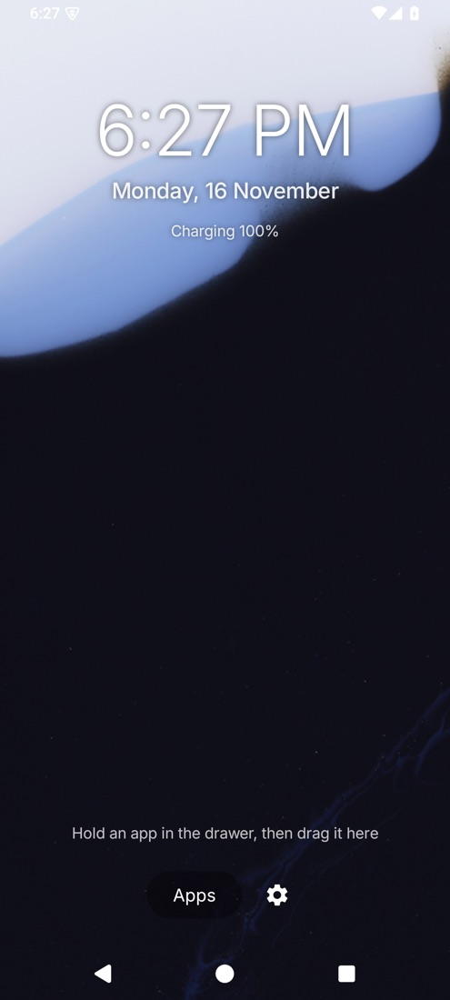
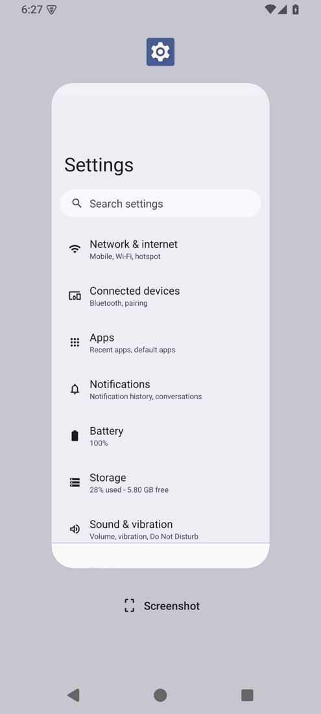

# Towards an operating system

## In plain words

Privacy Launcher is an app: a home screen you install on the Android your
phone already has.

An operating system would be all of Android with Privacy Launcher built
into it. The launcher would be the home screen from the very first time the
phone is switched on, it would still be there after a factory reset, and it
could not be removed.

**What exists today is a preview of that, in the emulator.** An emulator is
a pretend phone on a computer. In it, plain Android 15 starts straight into
Privacy Launcher, with Android's own buttons and recent-apps screen working:

<p>
  
  
</p>

**What does not exist is a version for a real phone.** Nothing here can be
installed on one. [What a phone needs](#what-a-phone-needs) says why, and
what it would take.

## What the preview is

It is the emulator's own copy of Android 15, the plain open-source image
with no Google apps, with one thing added to its system partition: the
launcher, at `/system/priv-app/PrivacyLauncher/`. That is where
[`rom/Android.bp`](../rom/Android.bp) would put it in a real build.

It is not an operating system built from source. It is Android as Google's
emulator ships it, with one app moved into it. To change the system
partition at all, the script switches off Android's check of that partition
(verified boot) inside the emulator. A real build would not need to: the
launcher would be part of the signed image.

Its purpose is to find out, in minutes instead of days, how the launcher
behaves as a system app. It found three things that were wrong in this
project's own build instructions ([below](#what-building-it-found)).

## Try it

On the Mac this project is developed on (Apple Silicon, with the Android SDK
and the Android 15 emulator image that `tools/emulators.sh create modern`
installs):

```bash
./gradlew assembleRelease
tools/os-preview.sh build            # make it, factory-reset it, check it
tools/os-preview.sh start --window   # watch it
tools/os-preview.sh stop
```

`build` takes a few minutes. It makes a separate emulator called `pl_os`,
so the three test emulators are not touched, and `tools/os-preview.sh
delete` removes it again. It uses the arm64 image, so on a computer with an
Intel or AMD processor the image name in the script would have to change.

## What the checks prove

`tools/os-preview.sh check` runs these as the ordinary, unprivileged shell
user. All of them passed on 16 November 2026, on the Android 15 emulator
image `AE3A.240806.019`, straight after a factory reset.

| Check | How |
|---|---|
| After a factory reset, the first screen is the launcher, with no "choose a home app" question | the activity on top once the first boot settles |
| The launcher is in the system partition | `pm path` gives `/system/priv-app/PrivacyLauncher/PrivacyLauncher.apk` |
| Android counts it as part of the system | its flags include `SYSTEM` and `PRIVILEGED` |
| It is the same file that was built | SHA-256 of the file in the system against the APK |
| Still no internet | no network permission, and not in the group (3003) a process must be in to open a network socket |
| It is Android's home screen without anyone choosing it | what Android resolves the Home button to, and who holds the home role |
| Android's navigation service is running | SystemUI reports it connected, and Android's own launcher has not crashed since boot |
| The recent-apps screen opens | the activity on top after pressing the recent-apps button |
| Pressing Home shows the launcher | the activity on top after pressing Home |
| It cannot be uninstalled like an ordinary app | `pm uninstall` fails, and it is still there |

What they do not prove: anything about a real phone, or about any Android
version other than 15. The emulator draws the screen in software and runs
on a processor several times faster than a budget phone's.

## What building it found

**Android's own launcher has to stay.** The plan in `rom/` was to remove it
from the image, so that there would be one home app and no question on
first boot. In Android 15 the recent-apps screen and the navigation buttons
are a service inside that launcher. With the launcher taken away, the
navigation-service check and the recent-apps check both fail.

**Switching off only its home screen does not work either.** That was the
second attempt, with a `component-override` in a sysconfig file. The
service then crashes every time it starts:

```
java.lang.RuntimeException: Unable to create service
com.android.quickstep.TouchInteractionService: java.lang.NullPointerException
    at com.android.quickstep.OverviewComponentObserver.<init>
```

It looks up its own home screen as it starts, and finds nothing.

**What works: a priority.** The launcher's manifest now gives its home
screen a priority of 1. Android honours a priority above 0 only for a
privileged app in the system image, where it puts this home screen ahead of
the stock one, so it is used from the first boot without asking. For an
ordinary installed app Android sets the priority back to 0: installed the
usual way on the Android 15 test emulator, the same build is listed with
`priority=0`, next to the stock launcher's 0, exactly as before the change.

**"Modify system settings" is on from the first boot.** As an installed app
the launcher has to be given that permission by the user, on Android's own
screen. Android grants it to every app in the system image without asking.
The launcher still uses it only for the brightness slider, but the README's
"asleep until you use them" is not true of this permission in a system
build, and an operating system's documentation would have to say so.

**The emulator's "wipe data" is not a factory reset.** It also throws away
the emulator's writable copy of the system partition, launcher included, and
so does starting the emulator with one of its data disks missing. The
script's `reset` empties only the three user-data disks and leaves the
system disk alone, which is what a phone's factory reset does.

## What a phone needs

An operating system for a phone is built for one exact model, from
Android's source code. Google's own
[requirements](https://source.android.com/docs/setup/start/requirements)
for that are a Linux computer with at least 400 GB of free disk and 64 GB
of memory, where a full build takes about six hours on six processor cores.
It cannot be done on a Mac at all: Android has not supported building on
macOS since 2021. The Mac this project is developed on has 16 GB of memory.

Then the phone has to allow it. Installing another operating system means
unlocking the phone, which wipes it, is not possible on every model, and on
some makers' phones permanently marks the phone as modified. It can also
leave a phone that does not start.

Three shortcuts were looked at and turned down:

- **Google's ready-made generic system images.** These are complete Android
  system images that many phones can start. Google's
  [download page](https://developer.android.com/topic/generic-system-image/releases)
  says they are for app developers to test with and are not to be
  redistributed, so an image made by adding the launcher to one could not be
  published.
- **The builds from Android's public build servers.** These come from the
  open-source code, but the system images offered there when this was
  written were debug builds, made for developers. A debug build lets a
  computer connected for debugging take full control of the phone, which a
  release build never allows. That is the opposite of what this project is
  for.
- **Free build machines.** The machines GitHub lends to open-source
  projects, which build and test this app, have a small fraction of the
  disk and memory a build of Android needs, and stop each job after six
  hours.

So the next step towards a phone is a Linux machine of the size Google
names, owned or rented by the hour, and one phone model to build for. The
files in [`rom/`](../rom/README.md), corrected by this preview, are what
goes into that build.

None of this has been compared with any other operating system, and no
claim is made about how it would compare.
